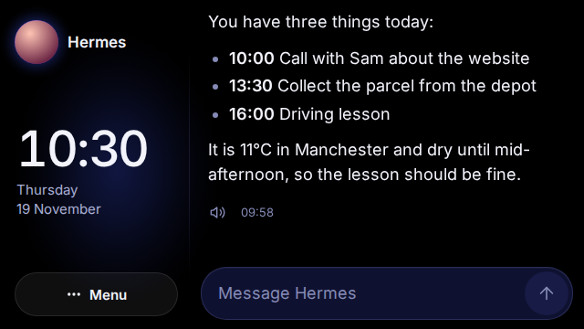
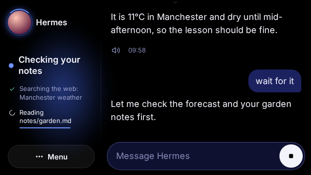
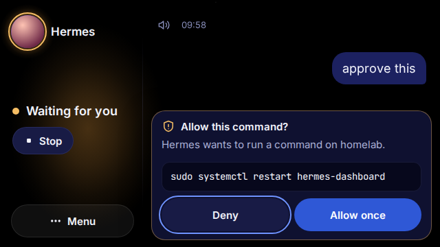
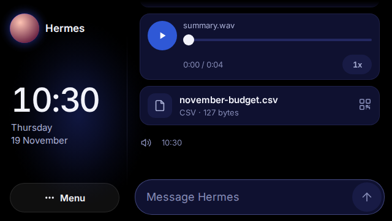
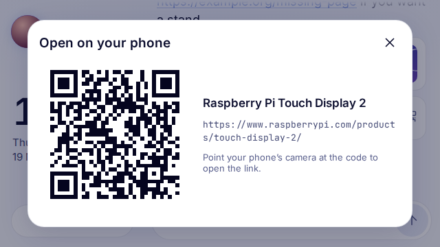

# Lantern

**A desk device for your own Hermes Agent.** A Raspberry Pi 4 behind a 5-inch touchscreen, turned
landscape, that boots straight into a conversation with your self-hosted
[Hermes](https://github.com/NousResearch/hermes-agent). No desktop, no browser chrome, nothing to
open: power it on and Hermes is there.

Lantern was called Hermlet up to version 0.1, a small SDK and app for personal devices. That
version is still in the history.

<p align="center">
  
  
</p>

<p align="center"><sub>Drawn at the panel's real resolution (1280x720) from the UI's screenshot tests.</sub></p>

## What it does

| | |
|---|---|
| **A face for the desk** | Beside the conversation, a panel shows who you are talking to and the time. While Hermes works it lists what it is doing, tool by tool. The screen is true black, so it melts into the display's black glass, and a soft light behind the panel shows Hermes's state: calm when idle, breathing while it works, amber when it needs you |
| **Simple by default** | Just talk to your agent: the desk is one conversation, the same main chat your phone and computer show, so you can carry on where you left off. Profiles, side chats and compaction are one switch away in Settings |
| **Replies as they are written** | A soft animation while Hermes thinks (its reasoning stays out of the way), then the reply streams at a steady reading pace, with Markdown, tables and highlighted code |
| **Hermes's commands** | Type `/` for the commands Hermes's other apps offer, such as `/usage`, `/title`, `/personality` and your skills, with a list that narrows as you type |
| **Pictures, audio and files** | Whatever the agent sends appears inline. Pictures open full screen, and audio has a player. Files get a QR code, so your phone can download them |
| **Links you can take with you** | Links become cards with the page's title and icon. Tap one for a large QR code to scan with your phone |
| **Read aloud** | Any reply can be spoken through Hermes's own text-to-speech, or every reply by choice |
| **Asks before risky things** | When Hermes wants approval for a command, the desk shows exactly what will run. From the desk you can allow it once or deny it, nothing broader |
| **Keyboard, mouse or touch** | Type anywhere to talk to Hermes. Every action has a shortcut (press `?` for the list), a mouse gets hover states, and the pointer hides itself when you are not using it |
| **Set up from your phone** | Scan a QR code on the desk and type your Hermes address and sign-in on your phone, the way you would sign in a games console. Or type them on the desk: a bare name is enough |
| **Built like an appliance** | A quiet boot splash and no console. Logs and swap stay in RAM to spare the SD card. It reconnects by itself and says plainly why when it cannot |

<p align="center">
  
  
  
</p>

## How it works

```
 the desk (Raspberry Pi 4)                                    your Hermes (VPS, home server)
┌────────────────────────────────────────────────────┐        ┌──────────────────────────┐
│ Chromium in a kiosk (cage), no desktop             │        │ hermes dashboard         │
│   the screen: a small web app, holds no secrets    │        │  /api/ws    chat, events │
│        │ 127.0.0.1 only, per-boot token            │Tailscale│  /api/sessions  history │
│ lantern run: the one connection to Hermes          │◄──────►│  /api/audio  speech      │
│   sign-in, history, media, link previews, speech   │        │                          │
└────────────────────────────────────────────────────┘        └──────────────────────────┘
```

- **It speaks the API Hermes's own apps use.** Nothing is installed on Hermes: no plugin, no
  restart, no new port.
- **One small service holds the connection and the sign-in.** The screen talks only to it, over
  127.0.0.1, and never sees a credential. `docs/local-api.md` is the contract between them.
- **Agent output is treated as untrusted.** Markdown is sanitised, and nothing navigates away from
  the chat. Link previews refuse private and tailnet addresses.

## Set it up

You need a Hermes you already run, and a way for the desk to reach it:
[Tailscale](https://tailscale.com) (recommended: the easiest, and encrypted), your home network,
or your own https address behind a reverse proxy. You also need:

- a Raspberry Pi 4 (2 GB is plenty) with the Raspberry Pi Touch Display 2 (5"), and a microSD card;
- optionally a Bluetooth keyboard and a speaker.

1. **Get Hermes ready** (once). Paste [prompts/setup-hermes.md](prompts/setup-hermes.md) into a chat
   with your Hermes. It checks the dashboard has a username and password, and that it is reachable
   on your tailnet. It also adds a short note so replies suit a small screen.
2. **Flash the card** with Raspberry Pi OS Lite (64-bit) using Raspberry Pi Imager. Set your Wi-Fi,
   a user and your SSH key there.
3. **Install.** Copy a release bundle to the Pi and run the installer:

   ```sh
   sudo bash install.sh --bundle lantern-0.2.0-arm64.tar.zst
   sudo tailscale up --ssh
   sudo reboot
   ```

   The screen is turned to landscape. If the picture comes up upside down for the way your
   display stands, run the installer again with `--rotate 270`; `--rotate 0` keeps it portrait.

   A coding agent can do this for you with [prompts/setup-device.md](prompts/setup-device.md).
4. **On the screen**, type your Hermes address and sign in. A bare name is enough: the desk works
   out `https://` or `http://...:9119` itself and tells you what it found. Or tap
   **Use your phone instead**, scan the QR code and type the details on your phone. That's all.

Without Tailscale, install with `--no-tailscale`. The desk warns you if an address would send
your password across the internet unencrypted.

To build a bundle yourself: `make bundle` (needs Node 20+ and Python 3.11+).

## Developing on a Mac (or any computer)

```sh
make setup           # Python venv with the dev tools, and the UI's packages
make fake &          # a stand-in Hermes on 127.0.0.1:9119 (user ada, password pw)
LANTERN_HOME=/tmp/lantern-dev .venv/bin/lantern setup http://127.0.0.1:9119 --username ada
make dev &           # the service, in development mode
cd ui && npm run dev # then open the address it prints at 640x360, device scale factor 2
```

The stand-in Hermes answers with scripted replies on certain words: `slow`, `media`, `links`,
`voice`, `approve`, `ask`, `error` and `long`. Each one shows a different state. Point the service
at your real Hermes instead with `lantern setup https://...`.

`make test` runs the checks that need no hardware. [AGENTS.md](AGENTS.md) is the guide to the code,
and [PLAN.md](PLAN.md) the plan and its milestones.

## Status

Version 0.2, in development. The service and the screen are built, and both are tested against a
stand-in Hermes. The connection, history, streaming, speech and compaction have been checked against
a real Hermes 0.22.5. **Nothing has run on the Raspberry Pi or the Touch Display 2 yet.** That
includes the installer, the kiosk, the splash, touch, memory and boot time.
[docs/tested.md](docs/tested.md) records exactly what has been run.

Before you rely on it: Hermes has no device-sized credential, so the desk holds a full dashboard
session. If you choose to, it also holds the password, so it can sign in again by itself. Treat
the SD card like a signed-in laptop. If it is lost, change your Hermes dashboard password, which
signs every device out.

## Credits

[Hermes Agent](https://github.com/NousResearch/hermes-agent) by Nous Research is the agent all of
this talks to. This is an unofficial community project, not affiliated with or endorsed by Nous
Research. The screen is built with [Preact](https://preactjs.com),
[markdown-it](https://github.com/markdown-it/markdown-it), [DOMPurify](https://github.com/cure53/DOMPurify)
and [highlight.js](https://highlightjs.org), and runs in [cage](https://github.com/cage-kiosk/cage)
and Chromium.

## Licence

MIT; see [LICENSE](LICENSE) and [NOTICE](NOTICE).
